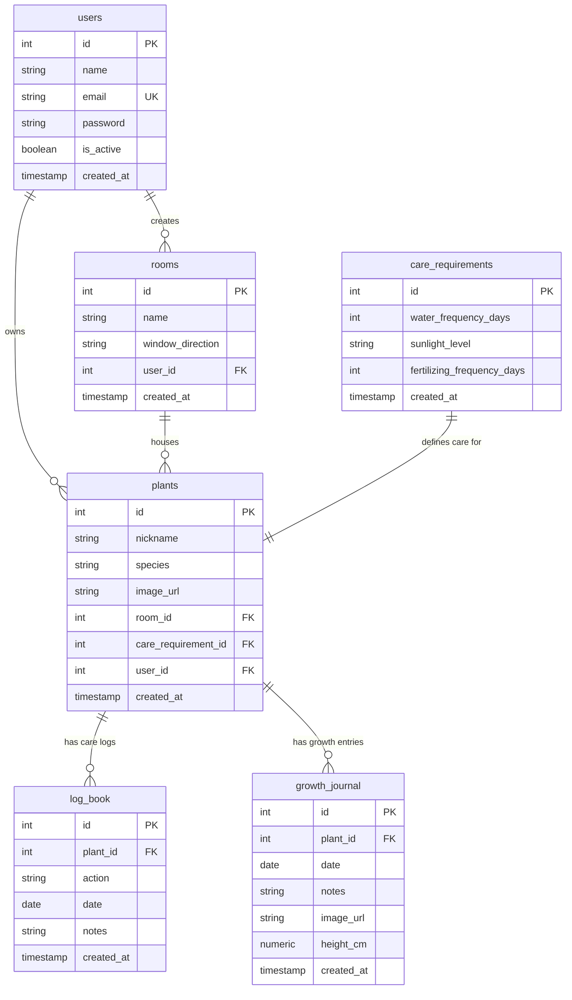

# LeafPulse — Database Design & Schema Specification

## 1. Entity-Relationship Diagram (ERD)



---

## 2. Table Specifications & Constraints

### 2.1 Table: `users`
| Column | Type | Constraints | Description |
|---|---|---|---|
| `id` | SERIAL | PRIMARY KEY | Unique user ID |
| `name` | VARCHAR(100) | NOT NULL | User's display name |
| `email` | VARCHAR(100) | UNIQUE, NOT NULL | Account login email |
| `password` | VARCHAR(255) | NOT NULL | 60-character bcrypt salted hash |
| `is_active` | BOOLEAN | DEFAULT true | Account status flag |
| `created_at` | TIMESTAMP | DEFAULT CURRENT_TIMESTAMP | Registration timestamp |

### 2.2 Table: `rooms`
| Column | Type | Constraints | Description |
|---|---|---|---|
| `id` | SERIAL | PRIMARY KEY | Unique room ID |
| `name` | VARCHAR(100) | NOT NULL | Room name (e.g. Living Room) |
| `window_direction` | VARCHAR(50) | NULLABLE | Orientation (South, East, etc.) |
| `user_id` | INTEGER | NOT NULL, REFERENCES users(id) ON DELETE CASCADE | Room owner |
| `created_at` | TIMESTAMP | DEFAULT CURRENT_TIMESTAMP | Creation timestamp |

### 2.3 Table: `care_requirements`
| Column | Type | Constraints | Description |
|---|---|---|---|
| `id` | SERIAL | PRIMARY KEY | Unique requirement ID |
| `water_frequency_days` | INTEGER | NOT NULL | Days between waterings |
| `sunlight_level` | VARCHAR(50) | NOT NULL, CHECK in ('Low','Medium','High') | Required lighting |
| `fertilizing_frequency_days` | INTEGER | DEFAULT 14 | Days between feedings |
| `created_at` | TIMESTAMP | DEFAULT CURRENT_TIMESTAMP | Creation timestamp |

### 2.4 Table: `plants`
| Column | Type | Constraints | Description |
|---|---|---|---|
| `id` | SERIAL | PRIMARY KEY | Unique plant ID |
| `nickname` | VARCHAR(100) | NOT NULL | User's plant nickname |
| `species` | VARCHAR(100) | NOT NULL | Botanical species name |
| `image_url` | VARCHAR(500) | NULLABLE | Path or URL to plant photo |
| `room_id` | INTEGER | NULLABLE, REFERENCES rooms(id) ON DELETE SET NULL | Room location |
| `care_requirement_id` | INTEGER | NOT NULL, REFERENCES care_requirements(id) ON DELETE CASCADE | Associated care rules |
| `user_id` | INTEGER | NOT NULL, REFERENCES users(id) ON DELETE CASCADE | Plant owner |
| `created_at` | TIMESTAMP | DEFAULT CURRENT_TIMESTAMP | Acquisition date |

### 2.5 Table: `log_book`
| Column | Type | Constraints | Description |
|---|---|---|---|
| `id` | SERIAL | PRIMARY KEY | Unique log ID |
| `plant_id` | INTEGER | NOT NULL, REFERENCES plants(id) ON DELETE CASCADE | Plant target |
| `action` | VARCHAR(20) | NOT NULL, CHECK in ('Watered','Fertilized','Pruned') | Care action type |
| `date` | DATE | NOT NULL | Date action occurred |
| `notes` | TEXT | NULLABLE | Care observations |
| `created_at` | TIMESTAMP | DEFAULT CURRENT_TIMESTAMP | Audit timestamp |

### 2.6 Table: `growth_journal`
| Column | Type | Constraints | Description |
|---|---|---|---|
| `id` | SERIAL | PRIMARY KEY | Unique journal entry ID |
| `plant_id` | INTEGER | NOT NULL, REFERENCES plants(id) ON DELETE CASCADE | Plant target |
| `date` | DATE | NOT NULL | Observation date |
| `notes` | TEXT | NOT NULL | Milestone observations |
| `image_url` | VARCHAR(500) | NULLABLE | Milestone image |
| `height_cm` | NUMERIC(5,2) | NULLABLE | Plant height in cm |
| `created_at` | TIMESTAMP | DEFAULT CURRENT_TIMESTAMP | Entry creation timestamp |

---

## 3. Performance Indexes
```sql
CREATE INDEX idx_users_email ON users(email);
CREATE INDEX idx_rooms_user_id ON rooms(user_id);
CREATE INDEX idx_plants_user_id ON plants(user_id);
CREATE INDEX idx_plants_room_id ON plants(room_id);
CREATE INDEX idx_plants_care_req_id ON plants(care_requirement_id);
CREATE INDEX idx_log_book_plant_id ON log_book(plant_id);
CREATE INDEX idx_log_book_date ON log_book(date);
CREATE INDEX idx_growth_journal_plant_id ON growth_journal(plant_id);
CREATE INDEX idx_growth_journal_date ON growth_journal(date);
```
