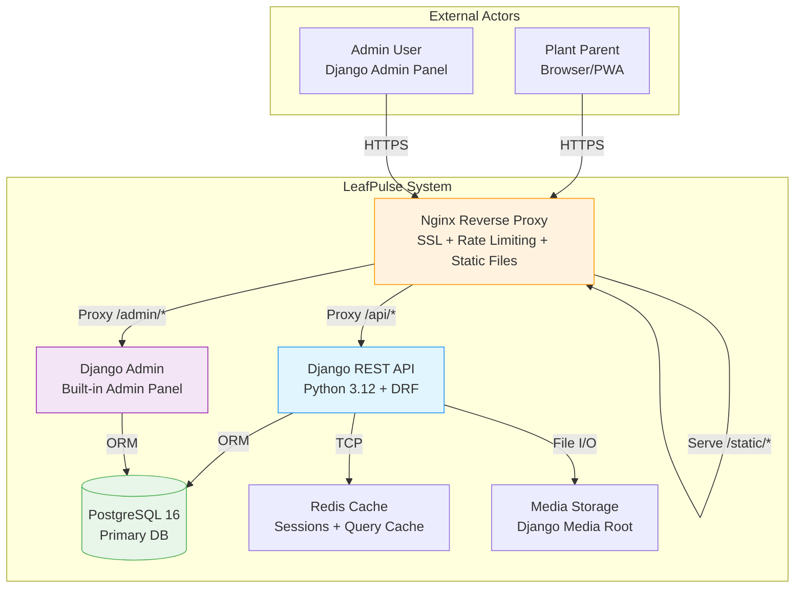
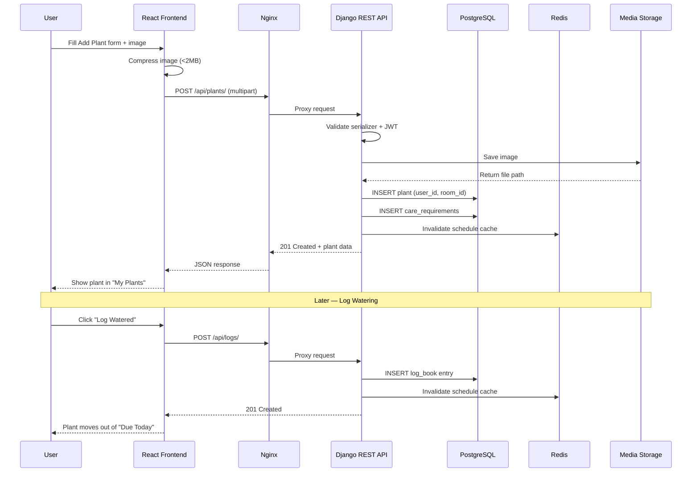
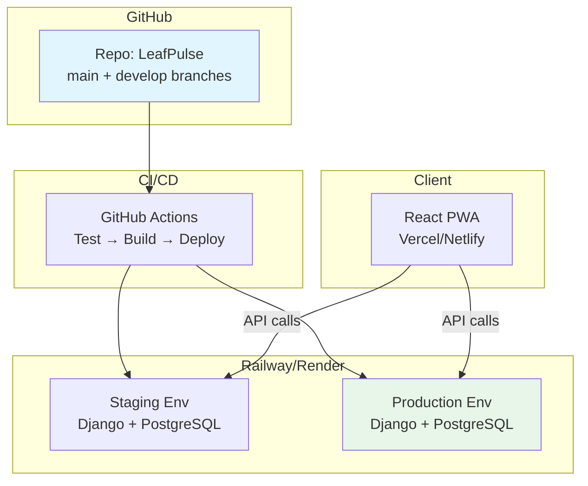

# Architecture Document
**Project:** LeafPulse – Indoor Houseplant Care Companion  
**Team Name:** GreenAura  
**Team Leader:** Tushar Kumar  
**Version:** 1.0 | **Date:** 2026-09-25 | **Status:** DRAFT  
**Author:** Tushar Kumar | **TRD Reference:** v1.0 (2026-09-25)

---

## 1. System Context Diagram



---

## 2. Component Breakdown

### 2.1 Nginx (Reverse Proxy + Static Server)
- **Role:** SSL termination, rate limiting, static file serving, reverse proxy
- **Config Highlights:**
  - Rate limit: 30 req/min/user for APIs; 100 req/min for static assets
  - Gzip compression enabled for JSON/CSS/JS
  - Security headers: CSP, X-Frame-Options, HSTS, X-Content-Type-Options
  - Serves React build (`/static/`) and Django static/admin files
- **Why Nginx?** Lightweight, production-grade, zero licensing cost, handles SSL + static efficiently

### 2.2 Django REST API (Backend Service)
- **Framework:** Django 5 + Django REST Framework 3.15
- **Apps (Modular Structure):**

| App | Responsibility | BRD Link |
|-----|---------------|----------|
| `accounts` | Custom user model, registration, login, JWT | FR-01 |
| `rooms` | Room CRUD, soft delete, user isolation | FR-02 |
| `plants` | Plant CRUD, image upload, search/filter | FR-03, FR-07 |
| `care` | Care requirements (water/sunlight/fertilizer) | FR-04 |
| `schedule` | Due-today calculation, upcoming plants | FR-05 |
| `logs` | Log book CRUD, action types, notes | FR-06 |
| `species` | Admin-managed plant species list | FR-08 |
| `core` | Shared utilities, permissions, pagination | All |

- **Patterns:**
  - Layered: `ViewSet → Serializer → Model → ORM`
  - DTOs via DRF Serializers (never expose raw models)
  - Custom permissions: `IsOwner` for user-scoped resources
  - Async tasks via Django `@shared_task` (Celery optional for v2)
  - Global exception handler with standardized error format

### 2.3 Data Layer

#### PostgreSQL 16 (Primary DB)
- **Tables:** `users`, `rooms`, `plants`, `care_requirements`, `log_book`, `species`
- **Indexes:**
  - `users.email` – B-tree unique
  - `rooms.user_id` – B-tree
  - `plants.user_id`, `plants.room_id` – B-tree
  - `log_book.plant_id + date` – Composite B-tree
  - `care_requirements.plant_id` – B-tree
- **Constraints:** FK integrity, CHECK on frequencies, ENUM on action/sunlight
- **pgAdmin:** Used locally for schema inspection, query testing, and migrations review

#### Redis 7 (Cache + Sessions)
- Session store (TTL 24h)
- Schedule query cache (TTL 5 min, invalidated on log create/update)
- Rate limit counters (sliding window)
- JWT blacklist for logout (optional)

#### Media Storage (Django Media Root)
- Local file storage for plant images (MVP)
- Client-side compression (≤2MB each)
- Served via Nginx in production
- Future: migrate to S3-compatible storage (MinIO) in v2

### 2.4 Django Admin Panel
- **Role:** Admin species management, user management, audit log viewing
- **Custom Actions:** Bulk approve species, export user data
- **Security:** Admin-only access; separate login; 2FA optional
- **Why Django Admin?** Zero-cost, built-in, audit-ready — no need for separate React admin dashboard in MVP

### 2.5 React PWA (Frontend)
- **Stack:** React 18 + Vite 5 + Tailwind CSS 3.4 + TypeScript 5
- **Structure:**
  ```
  src/
  ├── components/    # Reusable UI (Button, Card, Modal)
  ├── pages/         # Route-level (Dashboard, MyPlants, AddPlant)
  ├── hooks/         # Custom hooks (usePlants, useSchedule)
  ├── services/      # API client (axios + interceptors)
  ├── context/       # Auth context, Theme context
  ├── utils/         # Helpers, validators
  └── types/         # TypeScript interfaces
  ```
- **State Management:** React Context for auth; URL params for filters; no Redux
- **API Client:** Axios with JWT interceptor (auto-refresh on 401)
- **PWA:** Service worker caches plant/room data for offline viewing

---

## 3. Data Flow: Add Plant & Log Watering



---

## 4. Deployment Topology



- **Environments:** Dev (local) → Staging (Railway) → Prod (Railway, separate DB)
- **Frontend Hosting:** Vercel/Netlify free tier (static React build)
- **Backend Hosting:** Railway/Render free tier (Django + PostgreSQL)
- **Rollback:** One-click Railway rollback; Django migrations reversible
- **Secrets:** GitHub Secrets → Railway env vars; NEVER committed
- **pgAdmin:** Local only; NOT exposed in production

---

## 5. Security Architecture

| Layer | Measure | BRD Link |
|-------|---------|----------|
| Transport | TLS 1.3 via Nginx | NFR-Sec |
| Auth | JWT (access 15 min + refresh 7d) in httpOnly cookies | FR-01 |
| CSRF | Django CSRF middleware + SameSite=Strict | NFR-Sec |
| Input | DRF serializer validation on ALL endpoints | NFR-Sec |
| SQL Injection | Django ORM parameterized queries only | NFR-Sec |
| XSS | React auto-escapes; CSP header enforced | NFR-Sec |
| Passwords | bcrypt hashing; never logged | NFR-Compliance |
| Rate Limiting | DRF throttling per endpoint | NFR-Sec |
| Audit | Django Admin actions logged | FR-08 |
| Dependencies | `pip-audit` + `npm audit` on every PR | NFR-Sec |

---

## 6. Error Handling Strategy

```python
# Standardized error response format
{
    "error": {
        "code": "VALIDATION_ERROR",
        "message": "Water frequency must be between 1 and 30 days",
        "field": "water_frequency_days",
        "timestamp": "2026-09-25T10:30:00Z"
    }
}
```

- **Global Exception Handler:** Django middleware catches all exceptions
- **HTTP Codes:** 400 (validation), 401 (auth), 403 (permission), 404 (not found), 429 (rate limit), 500 (server)
- **Logging:** SLF4J-style structured logging; no PII in logs
- **Frontend:** Axios interceptor shows toast for errors; retry on 5xx

---

## 7. Scalability Plan

| Concern | MVP Solution | v2 Plan |
|---------|--------------|---------|
| DB Load | Indexes + Redis cache | Read replicas |
| Media Storage | Local Django media | S3/MinIO |
| Async Tasks | Django `@shared_task` | Celery + Redis broker |
| CDN | None | Cloudflare free tier |
| Horizontal Scaling | Single Railway instance | Multiple instances + load balancer |

---

## 8. Monitoring & Observability

| Tool | Purpose | Free Tier |
|------|---------|-----------|
| Sentry | Error tracking (backend + frontend) | 5K events/month |
| UptimeRobot | Uptime monitoring (5 min checks) | 50 monitors |
| Django Debug Toolbar | Local query profiling | Dev only |
| Railway Metrics | CPU, memory, requests | Built-in |
| PostgreSQL `pg_stat_statements` | Slow query detection | Built-in |

---

## 9. Architecture Decision Records (ADRs)

| ADR | Decision | Rationale | Alternative Rejected |
|-----|----------|-----------|---------------------|
| ADR-01 | Django REST over Node/Express | Team expertise; batteries-included; admin panel free | Express (more boilerplate) |
| ADR-02 | JWT in httpOnly cookies | XSS-safe; CSRF via SameSite | localStorage (XSS risk) |
| ADR-03 | PostgreSQL over SQLite | ACID; concurrent writes; pgAdmin | SQLite (no concurrency) |
| ADR-04 | Django Admin over custom React admin | Zero-cost; audit-ready; faster MVP | Custom React admin (time) |
| ADR-05 | Local media over S3 (MVP) | Zero cost; simple | S3 (cost + setup) |
| ADR-06 | Figma over Adobe XD | Team familiarity; free tier; collaboration | Adobe XD (paid) |
| ADR-07 | React Context over Redux | Simpler; less boilerplate; auth-only state | Redux (overkill) |

---

## 10. Traceability Matrix

| Architecture Item | BRD Requirement | Status | Notes |
|-------------------|-----------------|--------|-------|
| JWT auth with httpOnly cookies | FR-01 | Planned | SimpleJWT + custom user model |
| Room CRUD with soft delete | FR-02 | Planned | Django ViewSet + `is_deleted` flag |
| Plant CRUD with image upload | FR-03 | Planned | Pillow + Django media root |
| Care requirements (1:1 plant) | FR-04 | Planned | Separate model with CHECK constraints |
| Schedule due-today calculation | FR-05 | Planned | Query + Redis cache |
| Log book with action types | FR-06 | Planned | ENUM: Watered/Fertilized/Pruned |
| Plant search/filter | FR-07 | Planned | DRF SearchFilter + OrderingFilter |
| Admin species management | FR-08 | Planned | Django Admin + custom actions |
| In-app reminders | FR-09 | Nice to Have | Toast on dashboard |
| WCAG 2.1 AA compliance | NFR-A11y | Planned | axe-core CI gate |
| $0 licensing cost | NFR-Budget | Confirmed | All OSS; Railway free tier |
| FERPA-aligned PII handling | NFR-Compliance | Planned | bcrypt hashing; no plaintext |

---

## 11. File Structure (Project Root)

```
leafpulse/
│
├── public/
│   └── ...
│
├── src/
│   │
│   ├── assets/
│   │   ├── images/
│   │   └── icons/
│   │
│   ├── components/
│   │   ├── Navbar.jsx
│   │   ├── Footer.jsx
│   │   ├── PlantCard.jsx
│   │   ├── RoomCard.jsx
│   │   └── StatusBadge.jsx
│   │
│   ├── pages/
│   │   ├── Home.jsx
│   │   ├── Login.jsx
│   │   ├── Register.jsx
│   │   ├── Dashboard.jsx
│   │   ├── Plants.jsx
│   │   ├── AddPlant.jsx
│   │   ├── Rooms.jsx
│   │   ├── CareSchedule.jsx
│   │   └── LogBook.jsx
│   │
│   ├── services/
│   │   └── api.js
│   │
│   ├── context/
│   │   └── AuthContext.jsx
│   │
│   ├── App.jsx
│   ├── main.jsx
│   └── index.css
│
├── package.json
├── package-lock.json
├── vite.config.js
└── .gitignore


backend/
│
├── manage.py
│
├── config/
│   ├── __init__.py
│   ├── settings.py
│   ├── urls.py
│   ├── asgi.py
│   └── wsgi.py
│
├── users/
│   ├── migrations/
│   │   └── __init__.py
│   ├── __init__.py
│   ├── admin.py
│   ├── apps.py
│   ├── models.py
│   ├── serializers.py
│   ├── urls.py
│   ├── views.py
│   └── tests.py
│
├── plants/
│   ├── migrations/
│   │   └── __init__.py
│   ├── __init__.py
│   ├── admin.py
│   ├── apps.py
│   ├── models.py
│   ├── serializers.py
│   ├── urls.py
│   ├── views.py
│   └── tests.py
│
├── rooms/
│   ├── migrations/
│   │   └── __init__.py
│   ├── __init__.py
│   ├── admin.py
│   ├── apps.py
│   ├── models.py
│   ├── serializers.py
│   ├── urls.py
│   ├── views.py
│   └── tests.py
│
└── care_logs/
    ├── migrations/
    │   └── __init__.py
    ├── __init__.py
    ├── admin.py
    ├── apps.py
    ├── models.py
    ├── serializers.py
    ├── urls.py
    ├── views.py
    └── tests.py


database/
│
├── ER-Diagram/
│   └── plantcare-er-diagram.png
│
├── schema/
│   └── database-schema.md
│
├── queries/
│   ├── due-today.sql
│   ├── plant-queries.sql
│   └── reports.sql
│
└── README.md

---

**DOCUMENT CONTROL**  
Prepared By: Tushar Kumar | Reviewed By: Faculty Advisor  
Next Review Date: 2026-10-02 | Change Log: v1.0 Initial Draft

---

## ✅ Next Step

Aap is **Architecture Document** ko review karo. Agar approve hai, toh likho:

**"Rules do"**

Main aapko **Step 7: Rules_LeafPulse.md** dunga — jisme coding standards, AI guardrails, allowed/forbidden tech stack, security mandates, aur testing requirements hoga.