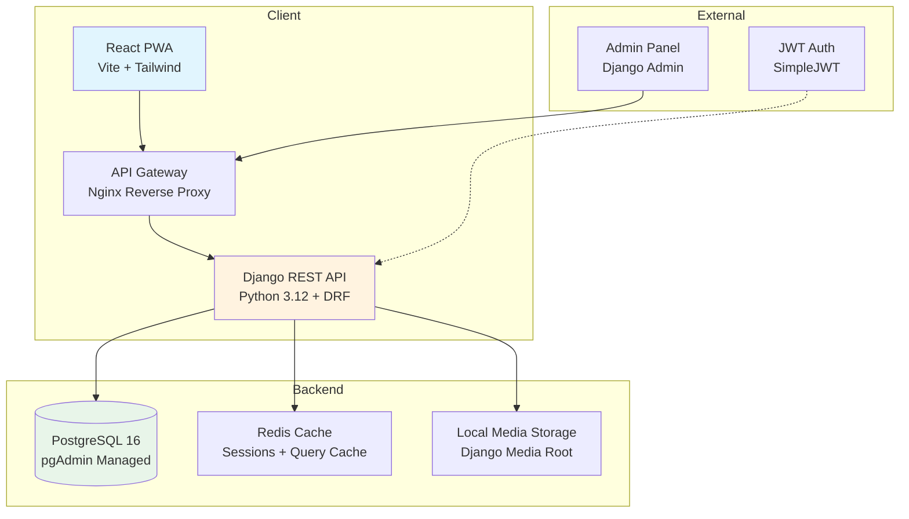

# Technical Requirements Document (TRD)
**Project:** LeafPulse – Indoor Houseplant Care Companion  
**Team Name:** GreenAura  
**Team Leader:** Tushar Kumar  
**Version:** 1.0 | **Date:** 2026-09-25 | **Status:** DRAFT  
**Author:** Tushar Kumar | **BRD Reference:** v1.0 (2026-09-25)

---

## 1. System Overview

LeafPulse is a mobile-responsive web app that helps indoor plant owners track plants, rooms, care schedules, and logs. Built on an open-source stack with **zero licensing cost**. All technical decisions trace directly to BRD requirements (see Traceability Matrix, Section 10).

---

## 2. Architecture Diagram



---

## 3. Tech Stack Specification

| Layer | Technology | Version | Justification | BRD Link |
|-------|-----------|---------|---------------|----------|
| Frontend | React + Vite | 18.x / 5.x | Fast HMR; small bundle; PWA-ready | FR-05, NFR-Perf |
| Styling | Tailwind CSS | 3.4.x | Utility-first; consistent design; mobile-first | NFR-A11y |
| Backend | Django + DRF | 5.x / 3.15.x | Batteries-included; ORM; admin panel free | All FRs |
| Database | PostgreSQL | 16.x | ACID; JSONB for flexible fields; pgAdmin GUI | FR-03, FR-04 |
| DB Tool | pgAdmin | 8.x | Visual schema management; query testing | NFR-Budget |
| Cache | Redis | 7.x | Session store; schedule query cache | FR-05, NFR-Perf |
| Auth | SimpleJWT | 5.x | Access + refresh tokens; httpOnly cookies | FR-01, NFR-Sec |
| UI/UX | Figma | Latest | Design system; handoff to frontend | NFR-A11y |
| Hosting | Docker + Railway/Render | - | Zero cost; auto-deploy from GitHub | NFR-Budget |
| Monitoring | Sentry + UptimeRobot | Free tier | Error tracking; uptime alerts | NFR-Perf |

---

## 4. Data Model (ER Diagram – Simplified)

```sql
-- Users table (custom Django user)
CREATE TABLE users (
    id UUID PRIMARY KEY DEFAULT gen_random_uuid(),
    name VARCHAR(100) NOT NULL,
    email VARCHAR(255) UNIQUE NOT NULL,
    password VARCHAR(255) NOT NULL,  -- bcrypt hashed
    is_active BOOLEAN DEFAULT TRUE,
    created_at TIMESTAMPTZ DEFAULT NOW()
);

-- Rooms table
CREATE TABLE rooms (
    id UUID PRIMARY KEY DEFAULT gen_random_uuid(),
    user_id UUID REFERENCES users(id) ON DELETE CASCADE,
    name VARCHAR(100) NOT NULL,
    window_direction VARCHAR(50),  -- North/South/East/West
    created_at TIMESTAMPTZ DEFAULT NOW()
);

-- Plants table
CREATE TABLE plants (
    id UUID PRIMARY KEY DEFAULT gen_random_uuid(),
    user_id UUID REFERENCES users(id) ON DELETE CASCADE,
    room_id UUID REFERENCES rooms(id) ON DELETE SET NULL,
    nickname VARCHAR(100) NOT NULL,
    species VARCHAR(100),
    image_url VARCHAR(500),
    created_at TIMESTAMPTZ DEFAULT NOW()
);

-- Care requirements table
CREATE TABLE care_requirements (
    id UUID PRIMARY KEY DEFAULT gen_random_uuid(),
    plant_id UUID REFERENCES plants(id) ON DELETE CASCADE,
    water_frequency_days INT CHECK (water_frequency_days BETWEEN 1 AND 30),
    sunlight_level VARCHAR(50) CHECK (sunlight_level IN ('Low', 'Medium', 'High')),
    fertilizing_frequency_days INT CHECK (fertilizing_frequency_days BETWEEN 1 AND 90),
    created_at TIMESTAMPTZ DEFAULT NOW()
);

-- Log book table
CREATE TABLE log_book (
    id UUID PRIMARY KEY DEFAULT gen_random_uuid(),
    plant_id UUID REFERENCES plants(id) ON DELETE CASCADE,
    action VARCHAR(20) CHECK (action IN ('Watered', 'Fertilized', 'Pruned')),
    date DATE DEFAULT CURRENT_DATE,
    notes TEXT,
    created_at TIMESTAMPTZ DEFAULT NOW()
);
```

### Relationships (from ER Diagram)
1. **User 1 → N Room** – A user can have multiple rooms
2. **Room 1 → N Plant** – A room can have multiple plants
3. **Plant 1 → 1 CareRequirement** – Each plant has one care requirement
4. **Plant 1 → N LogBook** – A plant can have many log entries
5. **User 1 → N Plant** – A user can have multiple plants

### Indexes
- `users.email` – B-tree unique
- `rooms.user_id` – B-tree
- `plants.user_id`, `plants.room_id` – B-tree
- `log_book.plant_id + date` – Composite B-tree
- `care_requirements.plant_id` – B-tree

---

## 5. API Specifications

| Endpoint | Method | Auth | Description | Rate Limit | BRD Link |
|----------|--------|------|-------------|------------|----------|
| `/api/auth/register` | POST | None | Register new user | 5/min/IP | FR-01 |
| `/api/auth/login` | POST | None | Login, return JWT | 10/min/IP | FR-01 |
| `/api/auth/refresh` | POST | Cookie | Refresh access token | 20/min/user | FR-01 |
| `/api/rooms` | GET | JWT | List user's rooms | 30/min/user | FR-02 |
| `/api/rooms` | POST | JWT | Create room | 10/min/user | FR-02 |
| `/api/rooms/{id}` | PUT | JWT | Update room | 10/min/user | FR-02 |
| `/api/rooms/{id}` | DELETE | JWT | Soft delete room | 5/min/user | FR-02 |
| `/api/plants` | GET | JWT | List/filter plants | 30/min/user | FR-03, FR-07 |
| `/api/plants` | POST | JWT | Add plant | 10/min/user | FR-03 |
| `/api/plants/{id}` | GET | JWT | Plant detail | 30/min/user | FR-03 |
| `/api/plants/{id}` | PUT | JWT | Update plant | 10/min/user | FR-03 |
| `/api/plants/{id}` | DELETE | JWT | Soft delete plant | 5/min/user | FR-03 |
| `/api/care-requirements` | POST | JWT | Set care requirement | 10/min/user | FR-04 |
| `/api/care-requirements/{plant_id}` | PUT | JWT | Update care requirement | 10/min/user | FR-04 |
| `/api/schedule` | GET | JWT | Get due/upcoming plants | 30/min/user | FR-05 |
| `/api/logs` | GET | JWT | List logs (filter by plant) | 30/min/user | FR-06 |
| `/api/logs` | POST | JWT | Create log entry | 15/min/user | FR-06 |
| `/api/admin/species` | GET/POST | Admin JWT | Manage species | 20/min/admin | FR-08 |

**Auth Pattern:** JWT access token (15 min expiry) + refresh token (7 days). Tokens stored in **httpOnly, Secure, SameSite=Strict cookies**. No localStorage.

---

## 6. Security & Compliance

- **Data Encryption:** AES-256 at rest (DB); TLS 1.3 in transit
- **PII Handling:** Only name + email stored; passwords hashed with bcrypt; never logged
- **Input Validation:** Django serializers validate ALL input; ORM prevents SQL injection
- **XSS Prevention:** React auto-escapes; CSP header enforced via Nginx
- **CSRF Protection:** Django CSRF middleware + SameSite cookies
- **Audit Logging:** Admin actions logged with timestamp + user ID
- **OWASP Top 10:** Addressed via Django security defaults + manual review checklist
- **Rate Limiting:** DRF throttling classes per endpoint

---

## 7. Performance Requirements

| Metric | Target | Measurement Method | BRD Link |
|--------|--------|-------------------|----------|
| Page Load (LCP) | <3s | Lighthouse CI on every PR | NFR-Perf |
| API Response (p95) | <800ms | Django Debug Toolbar + Sentry | FR-05 |
| Concurrent Users | 200 | k6 load test pre-launch | NFR-Perf |
| Uptime | 99% (academic hrs) | UptimeRobot free tier | NFR-Perf |
| Image Upload Time | <5s | Client-side compression + async upload | FR-03 |
| Schedule Query | <500ms | Redis cache + DB index | FR-05 |

---

## 8. Testing Strategy

| Type | Tool | Coverage Target | When | BRD Link |
|------|------|-----------------|------|----------|
| Unit | Pytest + Django TestCase | 80% backend logic | Every commit | All FRs |
| Integration | Pytest + DRF APIClient | Critical paths (auth, plants, logs) | Pre-merge | FR-01, FR-03, FR-06 |
| E2E | Playwright | User journeys (register→add plant→log) | Nightly | FR-05, FR-06 |
| Security | OWASP ZAP Baseline Scan | 0 high/critical findings | Pre-launch | NFR-Sec |
| Accessibility | axe-core + Playwright | WCAG 2.1 AA pass | Every PR | NFR-A11y |
| Frontend Unit | Jest + React Testing Library | 70% component coverage | Every commit | FR-05 |

---

## 9. Deployment & CI/CD

```yaml
# Simplified GitHub Actions pipeline
on: [push]
jobs:
  test:
    runs-on: ubuntu-latest
    steps:
      - run: python manage.py test       # Django unit + integration
      - run: npx playwright test         # E2E
      - run: npx lighthouse-ci           # Perf + A11y
      
  deploy-staging:
    needs: test
    if: github.ref == 'refs/heads/main'
    steps:
      - run: docker build && push
      - run: railway deploy --env staging
      
  deploy-prod:
    needs: deploy-staging
    if: github.event_name == 'release'
    steps:
      - run: railway promote staging → prod
      - run: smoke-test.sh               # Automated health check
```

- **Environments:** Dev (local) → Staging (Railway free tier) → Prod (same infra, separate DB)
- **Rollback:** One-click Railway rollback; Django migrations reversible
- **Secrets:** GitHub Secrets → Railway env vars; NEVER committed to repo
- **DB Migrations:** Django `makemigrations` + `migrate`; version-controlled
- **pgAdmin:** Used locally for schema inspection; NOT exposed in production

---

## 10. Traceability Matrix

| TRD Item | BRD Requirement | Status | Notes |
|----------|-----------------|--------|-------|
| JWT auth with httpOnly cookies | FR-01 | Planned | SimpleJWT + custom user model |
| Room CRUD with soft delete | FR-02 | Planned | Django ViewSet + `is_deleted` flag |
| Plant CRUD with image upload | FR-03 | Planned | Pillow + Django media root |
| Care requirements (water/sunlight/fertilizer) | FR-04 | Planned | Separate model, 1:1 with plant |
| Schedule due-today calculation | FR-05 | Planned | Query: `last_watered + frequency <= today` |
| Log book with action types | FR-06 | Planned | Enum: Watered/Fertilized/Pruned |
| Plant search/filter | FR-07 | Planned | DRF SearchFilter + OrderingFilter |
| Admin species management | FR-08 | Planned | Django Admin + custom actions |
| In-app reminders | FR-09 | Nice to Have | Toast on dashboard; no email/SMS |
| WCAG 2.1 AA compliance | NFR-A11y | Planned | axe-core CI gate |
| $0 licensing cost | NFR-Budget | Confirmed | All OSS; Railway free tier |
| PII handling (name/email only) | NFR-Compliance | Planned | bcrypt hashing; no plaintext storage |

---

## 11. Team Responsibilities (GreenAura – 7 Members)

| Role | Count | Responsibility |
|------|-------|----------------|
| Team Leader (Tushar Kumar) | 1 | Gate reviews, coordination, final decisions |
| UI/UX Designer | 1 | Figma wireframes, design system, accessibility |
| Frontend Developer | 2 | React + Tailwind components, API integration |
| Backend Developer | 2 | Django REST APIs, JWT auth, business logic |
| Database Administrator | 1 | PostgreSQL schema, pgAdmin, migrations |
| Research | 1 | User interviews, plant care data, validation |

---

**DOCUMENT CONTROL**  
Prepared By: Tushar Kumar | Reviewed By: Faculty Advisor  
Next Review Date: 2026-10-02 | Change Log: v1.0 Initial Draft

---
